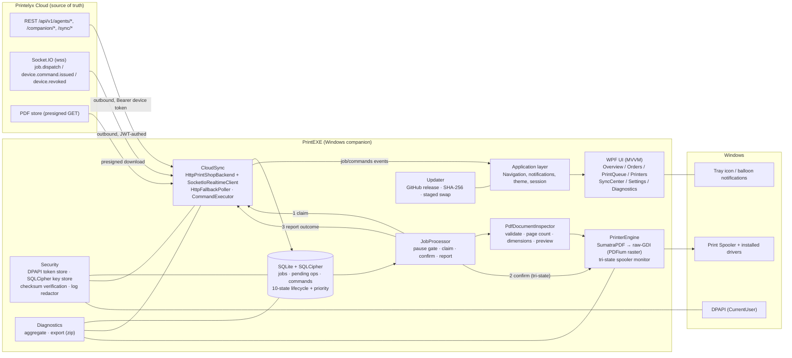

# PrintEXE — Target Architecture

**Date:** 2026-11-25 · Companion to `PRINTEXE_EXISTING_ARCHITECTURE.md`. The target preserves the existing solution structure (per the brief: "use the existing project names and solution structure where appropriate rather than introducing unnecessary projects") and maps it to the ten logical modules the brief names.

## 1. Module mapping

| Brief module | Realized in | Notes |
|---|---|---|
| PrintEXE.Desktop | `PrintShopCompanion.App` (WPF) | Single-TFM `net10.0-windows` |
| PrintEXE.Application | `App/ViewModels` + `App/Services` (MVVM application layer) | NavigationService, ThemeService, NotificationService, DiagnosticsViewModel |
| PrintEXE.Domain | `PrintShopCompanion.Core` | Models, contracts, options — platform-neutral |
| PrintEXE.Infrastructure | `PrintShopCompanion.Infrastructure` | HTTP, Socket.IO, storage, sync, updates, diagnostics, logging |
| PrintEXE.PrinterEngine | `Infrastructure/Printers` + `Infrastructure/Pdf` (Windows TFM for spooler code; neutral for PDF inspection) | Spooler integration, renderer chain, tri-state outcome monitor |
| PrintEXE.CloudSync | `Infrastructure/Backend` + `Infrastructure/Sync` + `Infrastructure/Commands` | Socket.IO + REST contract clients, pending-ops queue, remote commands |
| PrintEXE.LocalStorage | `Infrastructure/Queue` + `Infrastructure/Storage` | SQLCipher queue, DPAPI stores, retention |
| PrintEXE.Security | `Infrastructure/Storage` (DPAPI), `Infrastructure/Logging` (redactor), checksum gates | Device identity, fail-closed encryption, credential hygiene |
| PrintEXE.Diagnostics | `Infrastructure/Diagnostics` + Diagnostics screen | Aggregation + export |
| PrintEXE.Updater | `Infrastructure/Update` | GitHub Releases + SHA-256 + staged swap |
| (removed) | `PrintShopCompanion.Backend` | Legacy incompatible mock — superseded by the integration-test fake; scheduled for deletion |

## 2. Architecture diagram



## 3. Job state machine (authoritative)

```
Pending → Downloading → Rendering → Spooled → Printed → ReportedPrinted
              │                        │
              │                        ├─→ UncertainSpooled  (never auto-reprint; operator reconciles)
              │                        └─→ OutcomeUnknown    (report lost / claim leftover; heartbeat reconciles)
              ├─→ Failed (retryable, exponential backoff + jitter) → Pending (bounded by MaxAttempts)
              └─→ Failed (permanent)
Cancelled (operator / device-race loss)
```

Parallel state machines recorded on every job: `DeliveryStatus` (cloud_staged → transferring → received / delivery_failed) and `StorageStatus` (cloud_available → local_verified → cloud_deleted / local_deleted).

## 4. Database migrations

- Versioned via the `schema_version` table (one row per applied bump; additive `ALTER TABLE … ADD COLUMN` guarded by duplicate-column catch) plus tolerant column reads for legacy rows.
- History: v0.5 (delivery/storage/checksum/retention columns + SQLCipher + migration from v0.4.7 plain DB) → v0.6 (this branch: `priority`, `due_at`, `ix_jobs_priority`).
- Rules for future migrations: additive only; never rewrite customer job rows in place; destructive changes ship behind a new table + retention sweep.

## 5. Cloud contracts

Documented in `docs/PRINTEXE_API_CONTRACTS.md` — the 23-point verified contract (REST + Socket.IO) is treated as frozen; the companion never invents endpoints.

## 6. Background execution decision (brief §11)

**Hybrid, desktop-first.** The WPF tray app is the primary host (real session printer access: per-user default printers, network printer connections, interactive recovery UX). The Worker host exists for unattended/service deployments (`UseWindowsService`), with the documented LocalSystem caveats adopted from PrintNode's FAQ (per-user default printers and per-session network connections are NOT visible to a LocalSystem service — a dedicated service account or desktop-mode is the remedy). A separate privileged service process was deliberately NOT adopted: it would split printer-session state and complicate updates without adding value at current scale. The installer's Worker feature is optional (feature level 2).

## 7. Extension seams (where future work plugs in)

- Renderer chain: add an `IPdfRenderer` (e.g. direct PostScript passthrough à la PaperCut) by registering it in the composite's name map — no processor changes.
- Command types: add to the 7-type executor + contract doc — dedup/ack machinery unchanged.
- Shop-model evolution: `PrintJobRecord` already carries `ShopId` on every job (stamped at dispatch since D-12); multi-shop-per-device requires only a per-shop credential set + queue filter.
- Rush/due-time: backend can drive `priority`/`due_at` when the contract gains the fields — schema already in place (v0.6).
